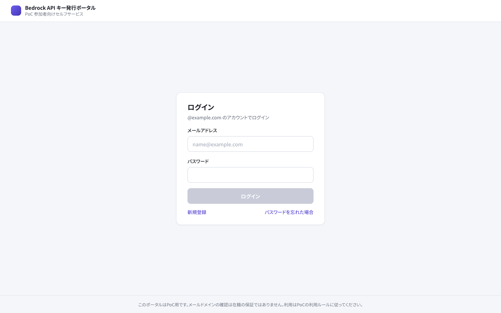
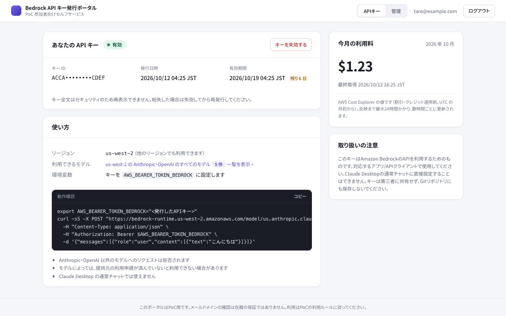
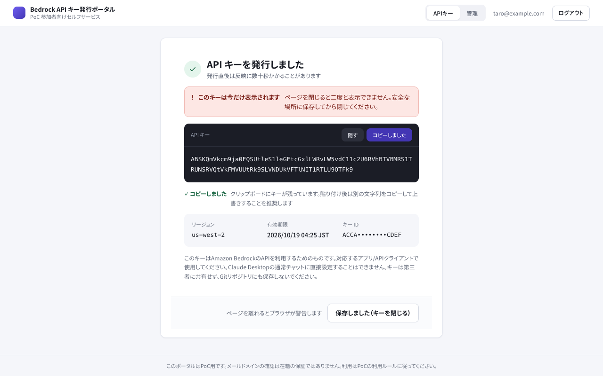
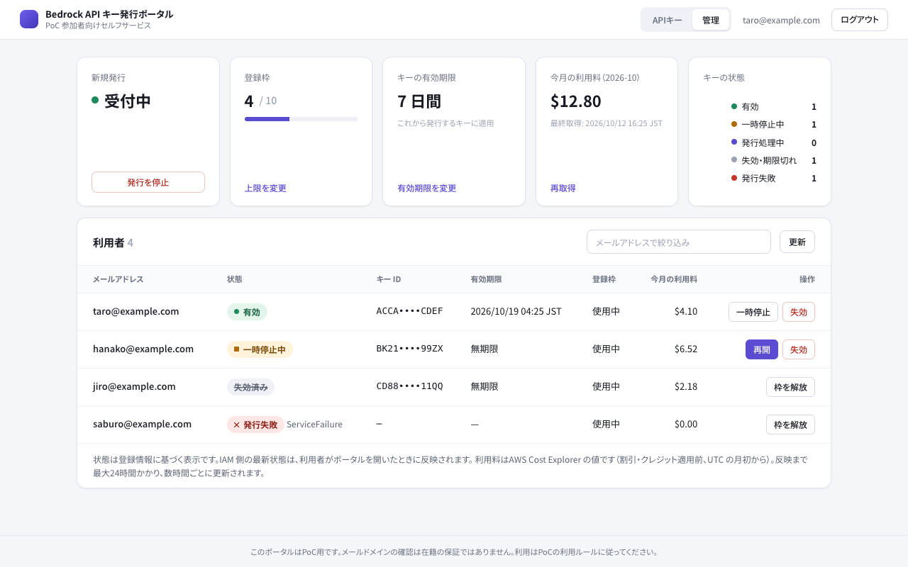
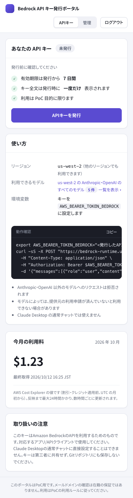
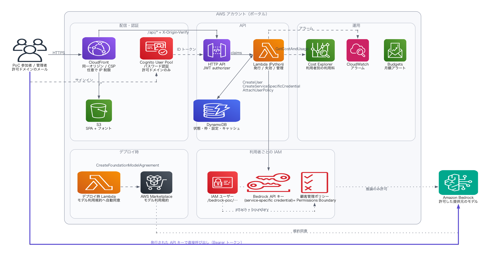
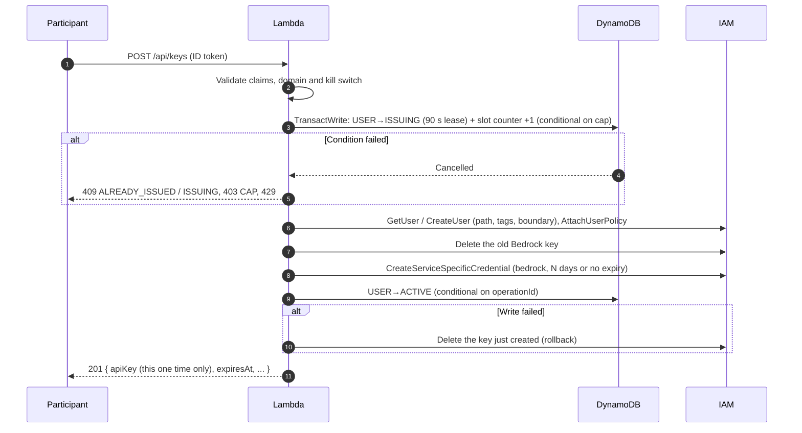

# Bedrock API Key Self-Service Portal (PoC)

[](https://github.com/ndmxjp/bedrock-api-key-portal/actions/workflows/ci.yml)

English | [日本語](README.md)

A self-service web portal for PoC participants. Anyone with an email address on an allowed domain signs in with email and password in the browser and issues their own long-term [Amazon Bedrock API key](https://docs.aws.amazon.com/bedrock/latest/userguide/api-keys.html) (an IAM service-specific credential), one key per person.

- Implementation plan: [docs/implementation-plan.md](docs/implementation-plan.md)
- Design: [docs/architecture.md](docs/architecture.md) / Security: [docs/security.md](docs/security.md)

The design documents and the portal UI are in Japanese.

> Long-term API keys are meant for exploration and evaluation. Move to short-term credentials or SSO before using this in production.
> Compatibility with the Codex app or Claude Desktop is not guaranteed. In particular, regular chat in Claude Desktop does not accept a Bedrock API key.

## Layout

```text
.
├── backend/    Python 3.14 Lambda (API and Cognito Pre sign-up trigger) + pytest
├── infra/      AWS CDK v2 (TypeScript) + CDK assertions tests
├── frontend/   React 19 + TypeScript + Vite + vitest
├── scripts/    Cleanup, reconciliation, kill switch, Bedrock smoke test
└── docs/
```

Tests live inside each package (`backend/tests`, `infra/test`, `frontend/src/*.test.tsx`) instead of the top-level `tests/` in the original spec, so each language's toolchain is self-contained.

| Layer | Technology | Version |
| --- | --- | --- |
| Frontend | React / Vite / TypeScript / Amplify Auth | 19.3 / 8.3 / 7.0 / 6.22 |
| Auth | Cognito User Pools (Lite plan, SRP password auth, Cognito's built-in email, self sign-up for allowed domains only) | — |
| API | API Gateway HTTP API + JWT authorizer + Lambda (Python 3.14, arm64, bundled boto3 1.43) | — |
| Storage | DynamoDB (on-demand, PITR) | — |
| IaC | AWS CDK | aws-cdk-lib 2.273 / CLI 2.1145 |
| Hosting | S3 + CloudFront (OAC) | — |

**Why S3 + CloudFront instead of Amplify Hosting:** one CloudFront domain can route `/api/*` to API Gateway, so the API shares the SPA's origin and needs no CORS. Security headers such as the CSP are also managed in one place in CDK.

## Screens

| Sign-in | API key (participant) |
| --- | --- |
|  |  |

| Key issued (shown only once) | Admin dashboard |
| --- | --- |
|  |  |

<details>
<summary>Mobile layout</summary>



</details>

Screenshots use dummy data. The key values shown are not real.

## Architecture



**Key points**

- **Keys are real Bedrock API keys.** After issuance, participants call Bedrock directly without going through the portal. The portal never stores the key and shows it exactly once, right after issuance.
- **DynamoDB is an index; IAM is the source of truth.** Key status (active, revoked, expired) is reconciled against IAM.
- **Double issuance and the headcount cap are decided in one transaction.** Repeated clicks or parallel requests cannot exceed the cap.
- **Permissions are narrowed in IAM.** The participant policy allows only inference actions and the allowed providers, and the same policy doubles as the permissions boundary. IAM condition keys restrict the issuer Lambda to Bedrock keys whose validity does not exceed the configured maximum.

**Issuance flow**



## Prerequisites

- Node.js 24 LTS or later, Python 3.14, [uv](https://docs.astral.sh/uv/) (used to package the Lambda; falls back to Docker if absent)
- A **dedicated AWS account for the PoC** is recommended
- CDK bootstrapped (`npx cdk bootstrap aws://<account>/<region>`)
- The deployer can assume the CDK bootstrap roles (CloudFormation creates IAM / Cognito / Lambda / API Gateway / DynamoDB / S3 / CloudFront / SNS / CloudWatch / Budgets resources)

## Setup

### 1. Choose the models

Do not guess inference profile IDs. Look them up in the actual account.

```bash
aws bedrock list-inference-profiles --region us-west-2 \
  --query 'inferenceProfileSummaries[].{id:inferenceProfileId,models:models[].modelArn}'
```

- The config takes the inference profile ID (e.g. `us.<provider>.<model>` / `global.<provider>.<model>`) and the foundation model ID it routes to (the part of `modelArn` after `foundation-model/`)
- Some models, such as Anthropic's, may require a first-time access request in the account. Enable them in the Bedrock console beforehand

### 2. Create the config file

```bash
cp infra/portal.config.example.json infra/portal.config.json   # not tracked by Git
```

| Key | Default | Description |
| --- | --- | --- |
| `stackName` | `BedrockApiKeyPortal` | CloudFormation stack name |
| `allowedDomains` | — | Allowed email domains (e.g. `example.com`). Exact match; subdomains are separate domains |
| `credentialAgeDays` | 7 | Initial validity in days for new keys. `"unlimited"` means no expiry. Admins can change it in the dashboard, and that value takes precedence |
| `maxCredentialAgeDays` | 30 | Maximum validity admins can choose (up to 36600). `"unlimited"` also allows keys without expiry |
| `registrationCap` | 10 | Maximum number of people who can be issued a key (per user; reissuing does not consume a slot) |
| `bedrockRegion` | `us-west-2` | Home region. Used for model agreements, the model list and usage examples. With `restrictRegion: true`, inference outside this region is denied |
| `restrictRegion` | true | `false` lets keys call Bedrock in any region (drops the IAM `aws:RequestedRegion` condition) |
| `inferenceProfiles` | — | Array of `{ id, modelId, label? }`. Models not listed are denied by IAM. Required when `allowAllModels` is false |
| `allowAllModels` | false | `true` allows every model in `bedrockRegion`. Every deploy automatically accepts the Marketplace agreements for all models available at that time |
| `allowedProviders` | [] | Used with `allowAllModels`. Allows and accepts agreements only for these providers (model ID prefixes, e.g. `["anthropic", "openai"]`). Empty means all providers |
| `alarmEmail` | none | Recipient of CloudWatch alarms and budget notifications (SNS sends a confirmation email) |
| `monthlyBudgetUsd` | none | Monthly AWS Budgets amount (notification only; usage is not stopped) |
| `removalPolicy` | `destroy` | `retain` keeps the table, user pool and other stateful resources when the stack is deleted |
| `issueCooldownSeconds` | 10 | Minimum interval between issuance attempts by the same user |
| `ses` | none | Send Cognito email through SES (see "Sending email with SES" below). `fromEmail`/`fromName`/`sesRegion`/`verifiedDomain`, or `route53: { hostedZoneId, zoneName }` |
| `portalAllowedCidrs` | [] | IPv4 CIDRs allowed to reach the portal (UI and API). Empty means no restriction |
| `keyAllowedCidrs` | [] | Source CIDRs (IPv4/IPv6) from which issued keys may call Bedrock. Empty means no restriction |

### 3. Deploy

```bash
make install
make test                       # unit tests (no AWS calls)
export AWS_PROFILE=<poc-account-profile>
export CDK_DEFAULT_REGION=ap-northeast-1   # region for the app (Cognito/API/DynamoDB)
make diff                       # review the changes
make deploy                     # add STACK=<stackName> if you changed the stack name
```

The `PortalUrl` output is the portal's URL. `UserPoolId` and `TableName` are used by the operations scripts.

If your shell sets `AWS_REGION`, the CDK CLI uses it instead of `CDK_DEFAULT_REGION`. Set both to the same region.

### 4. Register participants

Anyone with an address on an allowed domain (e.g. `@example.com`) can register themselves with 「新規登録」 (Sign up) in the portal. A confirmation code sent by email proves ownership of the address. Other domains are rejected by the Pre sign-up trigger, and the API checks the domain again.

> **Note:** In some environments, organizational security policies or automation disable Cognito self sign-up. The screen then shows 「現在、新規登録を受け付けていません」 (sign-up is currently closed). Register participants with an admin invitation as described below.

Admins can also invite participants, either from 「利用者を追加」 (Add participant) in the **admin dashboard** or with the CLI below (bulk registration from a file). Cognito sends an invitation email with a temporary password valid for 7 days. At first sign-in, participants set their own password (at least 12 characters, with uppercase, lowercase and digits). Addresses outside the allowed domains cannot be registered. The invitation email does not contain the portal URL, so share it separately.

**Email sending limit:** By default, Cognito's built-in email sender is used, which is limited to 50 messages per day per AWS account. This cannot be raised, and it counts sign-up confirmations, invitations and password resets alike. For many participants, set up "Sending email with SES (optional)" below or spread invitations over several days. If someone's temporary password expired, resend it with 「招待メールを再送」 (Resend invitation) in the dashboard or `--resend` in the CLI.

```bash
cd backend
uv run python ../scripts/invite_users.py --user-pool-id <UserPoolId> --region <app-region> \
  --file participants.txt                                          # review (dry-run)
uv run python ../scripts/invite_users.py --user-pool-id <UserPoolId> --region <app-region> \
  --file participants.txt --apply --expected-account <id>          # register and send invitations
uv run python ../scripts/invite_users.py --user-pool-id <UserPoolId> --region <app-region> --list
```

`registrationCap` limits how many people can be issued a key. It applies independently of how many are registered.

## End-to-end checks

| # | What to check | Steps |
| --- | --- | --- |
| 1 | An allowed domain can issue a key | Sign up → confirmation code → sign in → 「APIキーを発行」 (Issue API key). Invited users go temporary password → new password |
| 2 | The key is shown only once | Reload the page and confirm only the masked value remains |
| 3 | Other domains cannot register or issue | Sign-up is rejected (Pre sign-up). Calling the API directly also returns `403 DOMAIN_NOT_ALLOWED` |
| 4 | Unauthenticated requests fail | `curl -X POST $PortalUrl/api/keys` → 401 |
| 5 | Repeated clicks do not issue a second key | POST again after issuance → `409 ALREADY_ISSUED` |
| 6 | Inference works; disallowed models and regions are denied | `verify_bedrock.py` below |
| 7 | Revoked keys are denied | 「キーを失効する」 (Revoke key) → the allowed call in `verify_bedrock.py` returns 403 |
| 8 | Keys never appear in logs | Search CloudWatch Logs Insights for the first few characters of the key and confirm there are no hits |

```bash
export AWS_BEARER_TOKEN_BEDROCK='<issued key>'   # take care not to leave it in shell history
cd backend
uv run python ../scripts/verify_bedrock.py --region us-west-2 \
  --allowed <allowed inference profile ID> --denied <disallowed model ID> --denied-region us-east-1
unset AWS_BEARER_TOKEN_BEDROCK
```

IAM is eventually consistent, so inference may fail for a few tens of seconds right after issuance.

## Calling Bedrock with an issued key

| Use | Endpoint |
| --- | --- |
| Bedrock native API (Converse / InvokeModel, SDK default) | `https://bedrock-runtime.<region>.amazonaws.com` |
| OpenAI-compatible Chat Completions / Responses API (Codex, OpenAI SDK) | `https://bedrock-runtime.<region>.amazonaws.com/openai/v1` |

Authenticate with `Authorization: Bearer <API key>`, or set the `AWS_BEARER_TOKEN_BEDROCK` environment variable. The `bedrock-mantle` endpoint is not allowed by the policy.

## Sending email with SES (optional)

Sending Cognito email through Amazon SES removes the 50-per-day limit (after SES production access is approved, the quota starts at 50,000 per day). Add `ses` to the config file and redeploy. Without it, Cognito's built-in sender is used.

**A. Use a Route 53 domain (automated)**

```json
"ses": { "route53": { "hostedZoneId": "Z0123456789ABC", "zoneName": "poc-mail.example.com" } }
```

1. Deploy the SES stack first with `make deploy-ses`. It creates the DKIM, MAIL FROM and DMARC records in Route 53. The sender is `no-reply@<zoneName>`
2. Wait for verification to complete (usually a few minutes). Deploying the main stack while the identity is unverified fails in the Cognito configuration
   ```bash
   aws sesv2 get-email-identity --email-identity <zoneName> --region <app-region> \
     --query '{verified:VerifiedForSendingStatus,dkim:DkimAttributes.Status}'
   ```
3. `make deploy`

**B. Use an already verified SES identity**

```json
"ses": { "fromEmail": "no-reply@example.com", "fromName": "Bedrock PoC Portal", "verifiedDomain": "example.com" }
```

The domain (or address) must already be verified in the SES console. This works when the domain's DNS is hosted outside Route 53: add the DKIM records SES shows you at your DNS provider. Use `sesRegion` for an identity in a different region from the app.

**Both options:** In the SES sandbox you can only send to verified recipients, so request production access. SES charges by sending volume.

## Fonts

The UI font, Noto Sans JP (SIL Open Font License 1.1), is bundled in `frontend/public/fonts/`. The CSP blocks external fonts, so they are served from the same origin. To keep the size down, the Regular / Medium / Bold weights are subset to about 3,000 characters, mainly alphanumerics, kana, symbols and the Jōyō kanji (about 530 KB per weight). Fonts are served with a 1-year cache and are not re-downloaded when the app itself is redeployed.

Kanji outside the subset fall back to the OS's Japanese font. If new UI text renders poorly, rebuild the subset from the original font with `pyftsubset` (fonttools). The license is in `frontend/public/fonts/LICENSE-NotoSansJP.txt`.

## IP restriction (optional)

| Setting | What it restricts | How |
| --- | --- | --- |
| `portalAllowedCidrs` | The portal UI and API | A CloudFront Function checks the client IP and returns 403 otherwise. So the API Gateway URL cannot be called directly to bypass it, CloudFront adds a secret header (stored in Secrets Manager) that the Lambda verifies |
| `keyAllowedCidrs` | Bedrock calls made with issued keys | Adds an `aws:SourceIp` Deny to the participant IAM policy, which is also the permissions boundary. A leaked key cannot be used from IPs outside the list |

- `portalAllowedCidrs` supports IPv4 only. Enabling it disables IPv6 on CloudFront
- If you forget to include your own admin IP, you cannot undo it from the UI. Fix the config file and redeploy
- `keyAllowedCidrs` denies calls through VPC endpoints, because their source appears as `aws:VpcSourceIp`. Include every egress IP of your corporate VPN
- Both take effect when you change the config file and redeploy

## Admin dashboard

Members of the `PortalAdmins` group see an admin tab (「管理」) at the top of the portal.

- Stop and resume new issuance (kill switch)
- Change the validity of keys issued from now on (days, or no expiry if `maxCredentialAgeDays` is `"unlimited"`; existing keys are unchanged)
- Slot usage and the cap, changing the cap (1–1000; takes precedence over `registrationCap` in the config file), and headcount per key status
- Add participants (Cognito invitation that emails a temporary password; can also resend). Allowed-domain addresses only
- Participant list (filter by email). Suspend and resume keys, force-revoke, release slots

**Suspend vs. revoke:** Suspending disables the key in IAM and puts the participant on hold. Resuming re-enables the same key as long as it has not expired. A suspended participant cannot reissue a key, and the hold persists even after the key expires. Revocation cannot be undone.

Admin rights are granted and removed only with the CLI; the dashboard cannot create admins. The change takes effect after the person signs in again. Admins are also subject to the allowed-domain and verified-email checks.

```bash
cd backend
uv run python ../scripts/portal_admin.py add-admin --email <email> --user-pool-id <UserPoolId> --region <app-region>
uv run python ../scripts/portal_admin.py list-admins --user-pool-id <UserPoolId> --region <app-region>
uv run python ../scripts/portal_admin.py remove-admin --email <email> --user-pool-id <UserPoolId> --region <app-region>
```

## Accepting model agreements (Marketplace)

Some models, such as Anthropic's, require accepting a Marketplace agreement per account. Participant keys have no Marketplace permissions, so **on every deploy a dedicated function accepts the agreements for the target models** (all models available at that time with `allowAllModels`, otherwise the models in `inferenceProfiles`).

- Models whose provider use-case form (such as Anthropic's first-time use form) has not been submitted are not accepted. The result is shown as counts in the `ModelAgreementsSummary` stack output
- Deleting the stack does not cancel the agreements (subscriptions)
- When new models are released, redeploy to accept them. With `allowAllModels`, the IAM policy already allows every model in the region, so non-Marketplace models work without a redeploy

## Usage cost display

The portal reads this month's Bedrock cost (from the start of the month in UTC) from AWS Cost Explorer. Participants see their own amount; admins see the total and the amount per participant.

- This uses Bedrock's cost allocation by IAM principal. The `PortalSubjectHash` tag on the portal's IAM users appears in Cost Explorer as `iamPrincipal/PortalSubjectHash`
- **You must activate this tag as a cost allocation tag in the payer account (the Organization's management account).** The tag appears after a participant's Bedrock usage reaches billing (up to 24 hours). Usage before activation is not broken down by participant
- Amounts are before discounts and credits (UnblendedCost) and lag by up to 24 hours. Each Cost Explorer API request is billed, so results are cached in DynamoDB for 6 hours (an admin's 「再取得」 (Refresh) is allowed once every 15 minutes)

```bash
cd backend
uv run python ../scripts/activate_cost_tag.py --profile <payer-profile>                          # check status
uv run python ../scripts/activate_cost_tag.py --profile <payer-profile> --apply --expected-account <payer-id>
```

## Operations

Run everything from `backend/` with `uv run python ../scripts/<script>.py ...`.

| Purpose | Command |
| --- | --- |
| Pause issuance (kill switch) | `portal_admin.py disable-issuance --table <TableName> --region <app-region>` |
| Resume | `portal_admin.py enable-issuance --table ... --region ...` |
| Status and slot usage | `portal_admin.py status --table ... --region ...` |
| Release a participant's slot | `portal_admin.py release-slot --sub <Cognito sub> --table ... --region ...` |
| Detect orphaned users/keys | `reconcile.py --table ... --region ...` |
| Delete orphaned keys | `reconcile.py --table ... --region ... --fix-orphan-keys --apply --expected-account <id>` |

- **If someone missed the one-time display**: they can recover by revoking the key (「キーを失効する」) and issuing again (this does not consume a slot)
- **Alarms**: Lambda errors, issuance failures, IAM AccessDenied, an abnormal number of issuances per hour, and API 5xx are notified through SNS
- **Audit (CloudTrail)**: IAM is a global service, so `CreateUser` / `CreateServiceSpecificCredential` / `UpdateServiceSpecificCredential` / `DeleteServiceSpecificCredential` and similar events are recorded in the **us-east-1** event history (90 days by default). Create a trail if you need longer retention. Check the CloudTrail and Bedrock documentation for what is recorded for Bedrock inference calls (management events / data events, model invocation logging) and enable it as needed
- **IAM quotas**: Bedrock API keys have a per-user limit. On reissue, the old key is deleted before the new one is created

## Where costs arise

Prices change, so they are not listed here. Check each service's pricing page.

- Amazon Bedrock (inference tokens; the largest cost driver. **Budgets only notifies and does not stop usage**)
- AWS Cost Explorer API (fetching usage for the cost display; billed per request; caching keeps it to a few calls per day)
- Amazon Cognito (monthly active users on the Lite plan)
- Amazon SES (messages sent, when `ses` is configured)
- CloudFront (requests, data transfer), S3 (storage, requests)
- API Gateway HTTP API (requests), Lambda (invocations)
- DynamoDB (on-demand reads and writes, PITR)
- CloudWatch (log storage, custom metrics, alarms), SNS
- CloudFront Functions and Secrets Manager (when `portalAllowedCidrs` is enabled)
- AWS Budgets (may be charged depending on the number of budgets)

## Cleanup at the end of the PoC

`cdk destroy` **does not delete the IAM users or issued keys**, because the Lambda created them at runtime. Always run the scripts first. They only touch users that match all of: path `/bedrock-poc/`, name prefix `poc-bedrock-`, and tag `ManagedBy=BedrockPoCPortal`. No other IAM user is touched.

```bash
cd backend
uv run python ../scripts/cleanup.py                                                                     # 1. review targets (no changes)
uv run python ../scripts/portal_admin.py disable-issuance --table <TableName> --region <app-region>   # 2. stop new issuance
uv run python ../scripts/cleanup.py --deactivate-only --apply --expected-account <id>                  # 3. deactivate all keys
uv run python ../scripts/cleanup.py --apply --expected-account <id>                                    # 4. delete keys and users
cd .. && make destroy                                                                                  # 5. delete the stack
# If you used ses.route53, also delete the SES stack: cd infra && npx cdk destroy <stackName>-SesIdentity -c config=portal.config.json
```

- Users with unexpected access keys, passwords or similar attached are reported, not deleted
- With `removalPolicy: "destroy"`, the DynamoDB table, user pool and S3 buckets are deleted together with the stack

## CI

GitHub Actions (`.github/workflows/ci.yml`) runs on pushes and pull requests. It uses no AWS credentials.

- backend: ruff (lint / format), pytest, and a check that `requirements.txt` matches `uv.lock`
- frontend: tsc, vitest, production build
- infra: tsc, vitest, and `cdk synth` with `infra/ci/portal.config.json` (bundles the Lambda dependencies and checks the artifact imports cleanly)
- scripts: `--help` for each script

## Development

```bash
make lint && make test
# Local frontend development against a deployed stack's API
curl -s https://<PortalUrl>/config.json > frontend/public/config.json
cd frontend && VITE_API_PROXY=https://<PortalUrl> npm run dev
```

## Not implemented / limitations

- `POST /api/keys/rotate` is not implemented. Revoke and reissue instead
- No WAF (for cost reasons). API Gateway throttling, a per-user cooldown and Cognito's own protections limit repeated requests
- Of Bedrock's OpenAI-compatible APIs, Chat Completions and the Responses API on `bedrock-runtime` are allowed by the participant policy (including the `bedrock:InvokeModel` on the default project that the Responses API requires). The `bedrock-mantle` endpoint (`bedrock-mantle:CreateInference`) is not allowed
- Verifying an email domain does not prove employment. The headcount cap and usage rules compensate

## Future work

- IAM Identity Center / SSO integration and a move to short-term credentials
- WAF and Cognito Plus threat protection
- A key rotation API and automatic deletion of expired metadata (TTL)

## License

MIT License. See [LICENSE](LICENSE). The bundled Noto Sans JP font is under the SIL Open Font License 1.1 (`frontend/public/fonts/LICENSE-NotoSansJP.txt`).
