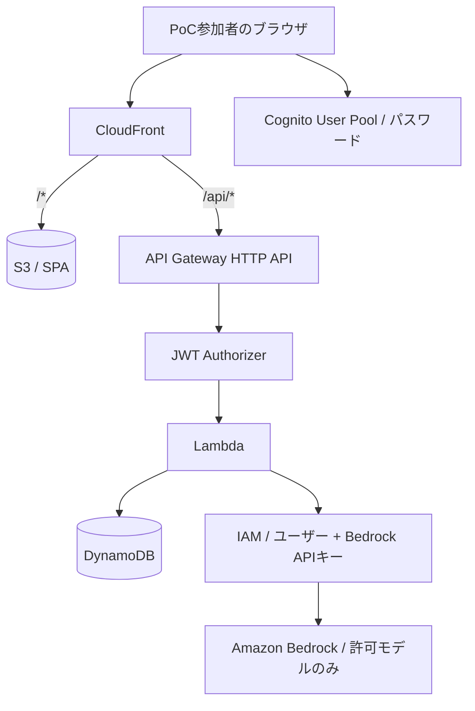

# Bedrock API Key Self-Service Portal (PoC)

A self-service web portal that lets people with an email address on an allowed domain sign up, sign in, and issue their own long-term [Amazon Bedrock API key](https://docs.aws.amazon.com/bedrock/latest/userguide/api-keys.html) (an IAM service-specific credential), one key per person. Built with React, AWS CDK, Cognito, API Gateway, Lambda (Python) and DynamoDB. Admins get a dashboard for caps, key validity, suspend/revoke and per-user Bedrock spend. Documentation is in Japanese. Licensed under the [MIT License](LICENSE).

指定ドメインのメールアドレスを持つ PoC 参加者が、ブラウザからメールアドレスとパスワードで認証し、Amazon Bedrock の長期 API キー（IAM service-specific credential）を 1 人 1 つセルフサービスで発行できる Web ポータルです。

- 実装計画: [docs/implementation-plan.md](docs/implementation-plan.md)
- 設計: [docs/architecture.md](docs/architecture.md) ／ セキュリティ: [docs/security.md](docs/security.md)

> 長期 API キーは探索・検証用途向けです。本番採用時は短期認証情報 / SSO 方式へ見直してください。
> Codex App や Claude Desktop での動作を保証するものではありません。特に Claude Desktop の通常チャットは Bedrock API キーの入力先ではありません。

## 構成

```text
.
├── backend/    Python 3.14 Lambda（API と Cognito Pre sign-up トリガー）＋ pytest
├── infra/      AWS CDK v2 (TypeScript) ＋ CDK assertions テスト
├── frontend/   React 19 + TypeScript + Vite ＋ vitest
├── scripts/    クリーンアップ・整合性チェック・キルスイッチ・Bedrock 動作確認
└── docs/
```

テストは各パッケージ配下（`backend/tests`, `infra/test`, `frontend/src/*.test.tsx`）に置いています（仕様の `tests/` から変更）。言語ごとのツールチェーンで完結させるためです。

| 層 | 採用技術 | バージョン |
| --- | --- | --- |
| Frontend | React / Vite / TypeScript / Amplify Auth | 19.3 / 8.3 / 7.0 / 6.22 |
| Auth | Cognito User Pools（Lite、パスワード認証 SRP、Cognito 既定のメール送信、許可ドメインのみセルフ登録可） | — |
| API | API Gateway HTTP API + JWT authorizer + Lambda (Python 3.14, arm64, boto3 1.43 同梱) | — |
| Storage | DynamoDB（オンデマンド、PITR） | — |
| IaC | AWS CDK | aws-cdk-lib 2.273 / CLI 2.1145 |
| Hosting | S3 + CloudFront（OAC） | — |

**Amplify Hosting ではなく S3 + CloudFront を選んだ理由:** 同じ CloudFront ドメインで `/api/*` を API Gateway に振り分けられ、API を同一オリジンにできる（CORS 不要）ためです。CSP などのセキュリティヘッダーも CDK で一元管理できます。



## 前提

- Node.js 24 LTS 以上、Python 3.14、[uv](https://docs.astral.sh/uv/)（Lambda のパッケージングに使用。無い場合は Docker にフォールバック）
- **PoC 専用の AWS アカウント**を推奨
- CDK ブートストラップ済み（`npx cdk bootstrap aws://<account>/<region>`）
- デプロイ担当者の権限: CDK ブートストラップロールを引き受けられること（CloudFormation 経由で IAM / Cognito / Lambda / API Gateway / DynamoDB / S3 / CloudFront / SNS / CloudWatch / Budgets を作成）

## セットアップ

### 1. 利用モデルを決める

推論プロファイル ID は推測せず、実アカウントで確認します。

```bash
aws bedrock list-inference-profiles --region us-west-2 \
  --query 'inferenceProfileSummaries[].{id:inferenceProfileId,models:models[].modelArn}'
```

- 設定には推論プロファイル ID（例 `us.<provider>.<model>` / `global.<provider>.<model>`）と、ルーティング先の基盤モデル ID（`modelArn` の `foundation-model/` 以降）を書きます
- Anthropic などのモデルは、アカウントで初回利用の申請（モデルアクセス）が必要な場合があります。Bedrock コンソールで事前に有効化してください

### 2. 設定ファイルを作る

```bash
cp infra/portal.config.example.json infra/portal.config.json   # Git 管理外
```

| キー | 既定値 | 説明 |
| --- | --- | --- |
| `stackName` | `BedrockApiKeyPortal` | CloudFormation スタック名 |
| `allowedDomains` | — | 許可ドメイン（例 `example.com`。完全一致で、サブドメインは別扱い） |
| `credentialAgeDays` | 7 | 新しいキーの有効日数の初期値。`"unlimited"` で無期限。管理画面から変更でき、その値が優先 |
| `maxCredentialAgeDays` | 30 | 管理画面で選べる有効日数の上限（最大 36600）。`"unlimited"` にすると無期限のキーも発行可能 |
| `registrationCap` | 10 | 発行できる人数の上限（ユーザー単位。再発行では消費しない） |
| `bedrockRegion` | `us-west-2` | 基準のリージョン。利用規約の同意・モデル一覧・使い方の例に使う。`restrictRegion` が true ならここ以外の推論を拒否 |
| `restrictRegion` | true | false にすると、キーはどのリージョンの Bedrock でも使える（IAM の `aws:RequestedRegion` 条件を外す） |
| `inferenceProfiles` | — | `{ id, modelId, label? }` の配列。ここに無いモデルは IAM で拒否（`allowAllModels` が false のとき必須） |
| `allowAllModels` | false | true にすると `bedrockRegion` のすべてのモデルを許可。デプロイのたびに、その時点の全モデルの Marketplace 利用規約に自動同意する |
| `allowedProviders` | [] | `allowAllModels` と併用。指定した提供元（モデル ID の接頭辞。例 `["anthropic", "openai"]`）のモデルだけを許可・同意する。空なら全提供元 |
| `alarmEmail` | なし | CloudWatch アラームと予算通知の宛先（SNS のメール確認が届きます） |
| `monthlyBudgetUsd` | なし | AWS Budgets の月額予算（通知のみ。利用は止まりません） |
| `removalPolicy` | `destroy` | `retain` にするとテーブル・ユーザープール等を削除時に残す |
| `issueCooldownSeconds` | 10 | 同一ユーザーの発行試行の最小間隔 |
| `portalAllowedCidrs` | [] | ポータル（画面と API）にアクセスできる IPv4 CIDR。空なら制限なし |
| `keyAllowedCidrs` | [] | 発行したキーで Bedrock を呼べる送信元 CIDR（IPv4/IPv6）。空なら制限なし |

### 3. デプロイ

```bash
make install
make test                       # 単体テスト（AWS は呼ばない）
export AWS_PROFILE=<poc-account-profile>
export CDK_DEFAULT_REGION=ap-northeast-1   # アプリ（Cognito/API/DynamoDB）を置くリージョン
make diff                       # 変更内容を確認
make deploy                     # スタック名を変えた場合は STACK=<stackName> を付ける
```

出力の `PortalUrl` がポータルの URL です。`UserPoolId` と `TableName` は運用スクリプトで使います。

### 4. 参加者の登録

許可ドメイン（例 `@example.com`）のアドレスなら、ポータルの「新規登録」から自分で登録できます。メールに届く確認コードで所有を確認します。他ドメインは Pre sign-up トリガーで拒否され、API でも再検証します。

> **注意:** 組織のセキュリティポリシーや自動化によって Cognito のセルフサインアップが無効化される環境があります。無効化された場合は画面に「現在、新規登録を受け付けていません」と表示されるので、以下の管理者招待で登録してください。

管理者が参加者を招待することもできます。招待すると、Cognito から初期パスワード付きの招待メールが届きます（有効期限 7 日）。参加者は初回ログイン時に自分のパスワード（12 文字以上、英大文字・英小文字・数字を含む）を設定します。許可ドメイン外のアドレスは登録できません。招待メールにはポータルの URL が入らないので、URL は別途案内してください。

**メール送信の上限:** SES を使わず Cognito 既定のメール送信を使うため、送信数には AWS アカウントあたり 1 日の上限があります（50 通、引き上げ不可。招待とパスワード再設定の両方が対象）。参加者が多い場合は日を分けて招待してください。初期パスワードが期限切れになった人には `--resend` で再送します。

```bash
cd backend
uv run python ../scripts/invite_users.py --user-pool-id <UserPoolId> --region <app-region> \
  --file participants.txt                                          # 確認（dry-run）
uv run python ../scripts/invite_users.py --user-pool-id <UserPoolId> --region <app-region> \
  --file participants.txt --apply --expected-account <id>          # 登録して招待メールを送信
uv run python ../scripts/invite_users.py --user-pool-id <UserPoolId> --region <app-region> --list
```

`registrationCap` はキー発行人数の上限です。登録人数とは別に効きます。

## 動作確認（E2E）

| # | 確認内容 | 手順 |
| --- | --- | --- |
| 1 | 許可ドメインで発行できる | 新規登録 → 確認コード → ログイン → 「APIキーを発行」（招待の場合は初期パスワード → 新パスワード設定） |
| 2 | キーは一度だけ表示 | 画面を再読み込みし、マスク表示のみになることを確認 |
| 3 | 別ドメインは登録・発行不可 | 新規登録で拒否（Pre sign-up）。API 直叩きでも `403 DOMAIN_NOT_ALLOWED` |
| 4 | 未認証は不可 | `curl -X POST $PortalUrl/api/keys` → 401 |
| 5 | 連打で 2 本目が出ない | 発行済みで再度 POST → `409 ALREADY_ISSUED` |
| 6 | 推論できる / 禁止モデル・リージョンは拒否 | 下記 `verify_bedrock.py` |
| 7 | 失効後は拒否 | 「キーを失効する」→ `verify_bedrock.py` の allowed が 403 になる |
| 8 | ログにキーが無い | CloudWatch Logs Insights でキー先頭数文字を検索してヒットしないこと |

```bash
export AWS_BEARER_TOKEN_BEDROCK='<発行したキー>'   # シェル履歴に残さないよう注意
cd backend
uv run python ../scripts/verify_bedrock.py --region us-west-2 \
  --allowed <許可した推論プロファイルID> --denied <許可していないモデルID> --denied-region us-east-1
unset AWS_BEARER_TOKEN_BEDROCK
```

IAM は結果整合性のため、発行直後は数十秒ほど推論が失敗することがあります。

## フォント

画面のフォントは Noto Sans JP（SIL Open Font License 1.1）を `frontend/public/fonts/` に同梱しています。CSP で外部フォントを読めないため、同一オリジンから配信します。容量を抑えるため、Regular / Medium / Bold の 3 ウェイトを、英数字・かな・記号・常用漢字を中心とした約 3,000 字にサブセット化しています（1 ウェイト約 530 KB）。フォントは 1 年キャッシュで配信され、アプリ本体の再デプロイでは再取得されません。

サブセットに無い漢字は OS の日本語フォントで表示されます。UI の文言を追加して表示が崩れる場合は、`pyftsubset`（fonttools）で元フォントから作り直してください。ライセンスは `frontend/public/fonts/LICENSE-NotoSansJP.txt` です。

## IP 制限（オプション）

| 設定 | 制限の対象 | 仕組み |
| --- | --- | --- |
| `portalAllowedCidrs` | ポータルの画面と API | CloudFront Function が接続元 IP を照合し、それ以外は 403。API Gateway の URL を直接叩いて回避されないよう、CloudFront が秘密のヘッダー（Secrets Manager に保存）を付け、Lambda が検証する |
| `keyAllowedCidrs` | 発行したキーでの Bedrock 呼び出し | 利用者の IAM ポリシー（Permissions Boundary を兼ねる）に `aws:SourceIp` の Deny を追加。キーが漏えいしても許可外の IP からは使えない |

- `portalAllowedCidrs` は IPv4 のみ対応です。有効にすると CloudFront の IPv6 を無効にします
- 管理者自身の IP を含め忘れると、画面から設定を戻せません。設定ファイルを直して再デプロイしてください
- `keyAllowedCidrs` は VPC エンドポイント経由の呼び出しを拒否します（送信元が `aws:VpcSourceIp` になるため）。社内 VPN の出口 IP をすべて含めてください
- どちらも設定ファイルを変えて再デプロイすると反映されます

## 管理者画面

`PortalAdmins` グループのメンバーには、ポータル上部に「管理」タブが表示されます。

- 新規発行の停止・再開（キルスイッチ）
- これから発行するキーの有効期限の変更（日数、または `maxCredentialAgeDays` が `"unlimited"` なら無期限。発行済みのキーは変わらない）
- 登録枠の使用数と上限、上限の変更（1〜1000。設定ファイルの `registrationCap` より優先）、キーの状態ごとの人数
- 利用者一覧（メールアドレスで絞り込み）。キーの一時停止・再開、強制失効、登録枠の解放

**一時停止と失効の違い:** 一時停止はキーを IAM で無効にし、利用者を保留にします。再開すると同じキーがそのまま使えます（有効期限内の場合）。停止中の利用者は自分で再発行できず、期限切れを待っても保留は解けません。失効は元に戻せません。

管理者の付与・解除は CLI だけで行います（画面から管理者を増やすことはできません）。反映には対象者の再ログインが必要です。管理者にも許可ドメインとメール確認のチェックが適用されます。

```bash
cd backend
uv run python ../scripts/portal_admin.py add-admin --email <email> --user-pool-id <UserPoolId> --region <app-region>
uv run python ../scripts/portal_admin.py list-admins --user-pool-id <UserPoolId> --region <app-region>
uv run python ../scripts/portal_admin.py remove-admin --email <email> --user-pool-id <UserPoolId> --region <app-region>
```

## モデルの利用規約（Marketplace）への同意

Anthropic などのモデルは、アカウント単位で Marketplace の利用規約への同意が必要です。利用者のキーには Marketplace の権限がないため、**デプロイのたびに専用の関数が対象モデルの同意を自動で行います**（`allowAllModels` なら、その時点の全モデル。そうでなければ `inferenceProfiles` のモデル）。

- 提供元の利用申請（Anthropic の初回利用フォームなど）が未提出のモデルは同意されません。結果はスタック出力 `ModelAgreementsSummary` に件数で表示されます
- スタックを削除しても同意（購読）は解除されません
- 新しいモデルが出たら再デプロイすれば同意されます。`allowAllModels` の IAM ポリシーは地域内の全モデルを許可するため、Marketplace 以外のモデルは再デプロイなしでも使えます

## 利用料の表示

ポータルは AWS Cost Explorer から、今月（UTC の月初から）の Bedrock 利用料を取得します。利用者の画面には自分の金額、管理者画面には合計と利用者ごとの金額が出ます。

- Bedrock の「IAM principal によるコスト配分」を使います。ポータルの IAM ユーザーに付く `PortalSubjectHash` タグが、Cost Explorer では `iamPrincipal/PortalSubjectHash` として現れます
- **このタグを支払いアカウント（Organization の管理アカウント）でコスト配分タグとして有効化する必要があります。** タグは利用者の Bedrock 利用が請求に反映された後（最大 24 時間）に表示されます。有効化より前の利用分は利用者別に分かれません
- 値は割引・クレジット適用前（UnblendedCost）で、反映まで最大 24 時間遅れます。Cost Explorer API は 1 リクエストごとに課金されるため、結果は DynamoDB に 6 時間キャッシュします（管理者の「再取得」は 15 分に 1 回まで）

```bash
cd backend
uv run python ../scripts/activate_cost_tag.py --profile <payer-profile>                          # 状態確認
uv run python ../scripts/activate_cost_tag.py --profile <payer-profile> --apply --expected-account <payer-id>
```

## 運用

すべて `backend/` から `uv run python ../scripts/<script>.py ...` で実行します。

| 目的 | コマンド |
| --- | --- |
| 発行を一時停止（キルスイッチ） | `portal_admin.py disable-issuance --table <TableName> --region <app-region>` |
| 再開 | `portal_admin.py enable-issuance --table ... --region ...` |
| 状態と枠の使用数 | `portal_admin.py status --table ... --region ...` |
| 利用者の枠を解放 | `portal_admin.py release-slot --sub <Cognito sub> --table ... --region ...` |
| 孤児ユーザー/キーの検出 | `reconcile.py --table ... --region ...` |
| 孤児キーの削除 | `reconcile.py --table ... --region ... --fix-orphan-keys --apply --expected-account <id>` |

- **一度きりの表示を受け取れなかった場合**: 利用者が「キーを失効する」→「再発行」を行えば回復します（枠は消費しません）
- **アラーム**: Lambda エラー、発行失敗、IAM の AccessDenied、1 時間あたりの異常な発行数、API の 5xx を SNS で通知します
- **監査（CloudTrail）**: IAM はグローバルサービスのため、`CreateUser` / `CreateServiceSpecificCredential` / `UpdateServiceSpecificCredential` / `DeleteServiceSpecificCredential` などは **us-east-1** のイベント履歴に記録されます（既定 90 日）。長期保存が必要なら証跡を作成してください。Bedrock 推論呼び出しの記録範囲（管理イベント / データイベント、モデル呼び出しログ）は CloudTrail と Bedrock のドキュメントで確認し、必要に応じて有効化してください
- **IAM クォータ**: Bedrock API キーはユーザーあたりの上限があります。再発行時は古いキーを削除してから作成します

## 費用が発生する箇所

料金は変わるためここには書きません。各サービスの料金ページを確認してください。

- Amazon Bedrock（推論トークン。最大の費用要因。**Budgets は通知のみで停止しない**）
- AWS Cost Explorer API（利用料表示のための取得。1 リクエストごとに課金。キャッシュで数回/日に抑制）
- Amazon Cognito（Lite プランの月間アクティブユーザー）
- CloudFront（リクエスト・転送量）、S3（保存・リクエスト）
- API Gateway HTTP API（リクエスト）、Lambda（実行）
- DynamoDB（オンデマンド読み書き、PITR）
- CloudWatch（ログ保存、カスタムメトリクス、アラーム）、SNS
- CloudFront Functions と Secrets Manager（`portalAllowedCidrs` を有効にした場合）
- AWS Budgets（予算の数によっては有料）

## PoC 終了時のクリーンアップ

`cdk destroy` では **IAM ユーザーと発行済みキーは削除されません**（Lambda が実行時に作成したため）。必ず先にスクリプトで処理します。対象は「パス `/bedrock-poc/`・名前 `poc-bedrock-`・タグ `ManagedBy=BedrockPoCPortal`」をすべて満たすユーザーだけで、それ以外の IAM ユーザーには触れません。

```bash
cd backend
uv run python ../scripts/cleanup.py                                                                     # 1. 対象を確認（変更なし）
uv run python ../scripts/portal_admin.py disable-issuance --table <TableName> --region <app-region>   # 2. 新規発行を停止
uv run python ../scripts/cleanup.py --deactivate-only --apply --expected-account <id>                  # 3. 全キーを無効化
uv run python ../scripts/cleanup.py --apply --expected-account <id>                                    # 4. キー削除・ユーザー削除
cd .. && make destroy                                                                                  # 5. スタック削除
```

- 想定外のアクセスキーやパスワード等が付いたユーザーは削除せずに報告します
- `removalPolicy: "destroy"` の場合、DynamoDB テーブル・ユーザープール・S3 バケットはスタックと一緒に削除されます

## 開発

```bash
make lint && make test
# フロントエンドのローカル開発（デプロイ済みスタックの API を使う）
curl -s https://<PortalUrl>/config.json > frontend/public/config.json
cd frontend && VITE_API_PROXY=https://<PortalUrl> npm run dev
```

## 未実装・制約

- `POST /api/keys/rotate` は未実装。失効 → 再発行で代替します
- WAF は未導入（費用のため）。API Gateway のスロットリング、ユーザー単位のクールダウン、Cognito 側の保護で連打を抑えます
- 実 AWS へのデプロイと E2E 検証は未実施です（利用者の認証情報が必要なため）
- Bedrock の OpenAI 互換 API（Responses API 等）は別のアクション/エンドポイントを使う可能性があり、本ポリシーでは検証していません。Converse / InvokeModel 系を対象にしています
- メールドメインの確認は在籍の保証ではありません。人数上限と利用ルールで補います

## Future Work

- IAM Identity Center / SSO 連携と短期認証情報への移行
- WAF、Cognito Plus の脅威保護
- キーのローテーション API、期限切れメタデータの自動削除（TTL）

## ライセンス

MIT License。詳細は [LICENSE](LICENSE) を参照してください。同梱フォント Noto Sans JP は SIL Open Font License 1.1（`frontend/public/fonts/LICENSE-NotoSansJP.txt`）です。
