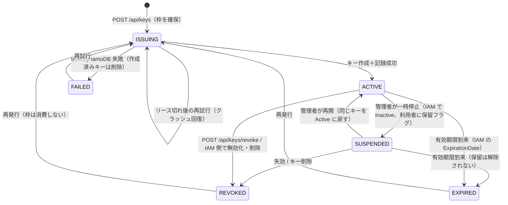

# アーキテクチャ

## コンポーネント

| コンポーネント | 役割 |
| --- | --- |
| CloudFront | SPA（S3, OAC）と `/api/*`（HTTP API）を同一オリジンで配信。CSP 等のセキュリティヘッダーを付与 |
| Cognito User Pool | Lite プラン。パスワード認証（SRP）。メールは Cognito 既定の送信機能（SES 不使用）。許可ドメインのみセルフ登録可（管理者招待も可）。Pre sign-up トリガーで許可ドメイン外を拒否 |
| HTTP API | 全ルートで Cognito JWT authorizer（ID トークン、aud = アプリクライアント）。ルート別スロットリング |
| API Lambda | `GET /api/me`, `POST /api/keys`, `POST /api/keys/revoke`、管理者向け `/api/admin/*`（概要、利用者一覧、強制失効、枠解放、キルスイッチ）。IAM 操作と DynamoDB 状態管理 |
| DynamoDB | 単一テーブル。利用者ごとの状態、発行枠カウンタ、キルスイッチ |
| IAM | 利用者ごとの IAM ユーザー（`/bedrock-poc/poc-bedrock-<hash>`）と Bedrock API キー |
| 顧客管理ポリシー `BedrockPoCUserPolicy` | 利用者に付与する Bedrock 権限。同じポリシーを Permissions Boundary にも設定 |

**認証とキーの責務は分離しています。** Cognito でログインできても Bedrock への権限は発生しません。Lambda が検証済みの利用者に対してだけ IAM ユーザーとキーを作成します。

## 認証フロー

1. セルフ登録: `SignUp`（メール＋パスワード）→ Pre sign-up トリガーがドメインを完全一致で検査 → メールの確認コードで `ConfirmSignUp`（`email_verified=true`）→ 自動サインイン
2. 管理者招待: `scripts/invite_users.py`（`AdminCreateUser`）→ 初期パスワード付き招待メール。初期パスワードを受け取れることがメール所有の証明
3. 参加者は SRP（`USER_SRP_AUTH`）でログインし、初回は `NEW_PASSWORD_REQUIRED` で自分のパスワードを設定する。忘れた場合は `ForgotPassword` → メールのコードで再設定
4. ユーザー存在エラーの防止が有効なので、未登録と誤パスワードは画面上区別しない
5. SPA は ID トークンを `Authorization: Bearer` で `/api/*` に送る。トークンは sessionStorage に保存（タブを閉じると消える）

## データモデル（`pk` のみの単一テーブル）

| pk | 属性 |
| --- | --- |
| `USER#` | `status`, `email`, `iamUserName`, `credentialId`, `issuedAt`, `expiresAt`, `updatedAt`, `operationId`, `leaseUntil`, `lastAttemptAt`, `errorCode`, `slotReserved`, `suspended`（管理者による保留。発行をブロック） |
| `META#COUNTER` | `reservedSlots` |
| `CONFIG#GLOBAL` | `issuanceEnabled`（無ければ有効）、`registrationCap`（管理画面で変更。無ければ設定ファイルの値） |
| `CACHE#COSTS#<YYYY-MM>` | Cost Explorer の取得結果（利用者別の今月の利用料）と取得時刻。6 時間キャッシュ |

API キー全文はどこにも保存しません。DynamoDB は IAM 状態のキャッシュ／索引で、真実の情報源は IAM です。`GET /api/me` のたびに ACTIVE のキーを IAM と突き合わせ、期限切れ・無効化・削除を反映します。

## 状態遷移

## 発行処理（`POST /api/keys`）

1. JWT claim を再検証（`token_use=id`, `iss`, `aud`, `exp`, `email_verified=true`）し、ドメインを完全一致で確認
2. キルスイッチを確認
3. **TransactWriteItems** で原子的に
   - 利用者レコードを `ISSUING` に（条件: レコード無し / REVOKED / EXPIRED / FAILED / リース切れ ISSUING、かつクールダウン経過、かつ読み取った `slotReserved` が変わっていない）
   - 初回利用者のみ `reservedSlots < cap` を条件に `+1`
   - 拒否理由から `409 ALREADY_ISSUED` / `409 ISSUING` / `429 RATE_LIMITED` / `403 REGISTRATION_CAP_REACHED` を返す
4. IAM ユーザーを取得、無ければ作成（パス・タグ・Permissions Boundary 付き）。既存ユーザーはパス・タグ・サブジェクトハッシュ・Boundary が一致しなければ**一切触らず**エラー
5. そのユーザーの Bedrock キーをすべて無効化・削除（失効済み・期限切れ・クラッシュ時の孤児。秘密値は未配布）
6. `CreateServiceSpecificCredential(ServiceName=bedrock.amazonaws.com, CredentialAgeDays=N)`。作成直後の `NoSuchEntity` は結果整合性として短時間リトライ
7. `operationId` を条件に `ACTIVE` を記録。失敗したら作成したキーを削除して `FAILED`
8. レスポンスでのみ `apiKey`（`ServiceSpecificCredential.ServiceCredentialSecret`）を返す

ISSUING のリース（90 秒）は Lambda タイムアウト（25 秒）より長いため、生きている処理が別のリクエストに乗っ取られることはありません。

## 失敗と回復

| 状況 | 回復 |
| --- | --- |
| IAM 呼び出し失敗 | `FAILED` を記録。クールダウン後に再試行可能 |
| キー作成後に DynamoDB 記録失敗 | 作成したキーを即削除して `FAILED` |
| Lambda がキー作成後にクラッシュ | リース切れ後、次の発行時に孤児キーを削除してから再作成。`reconcile.py` でも検出可能 |
| レスポンスが利用者に届かなかった | 失効 → 再発行（枠は消費しない） |
| 管理者が IAM でキーを無効化・削除 | 次回 `GET /api/me` で REVOKED に反映 |
